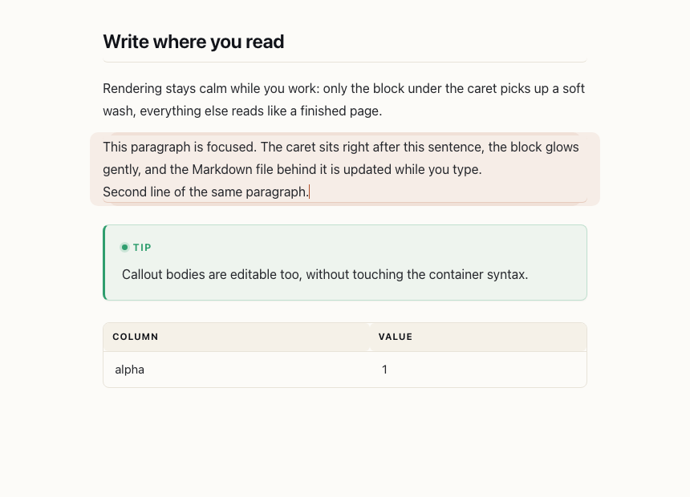
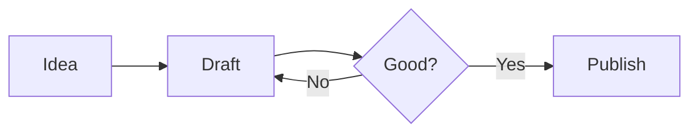

# Buity Markdown

**A calm, editorial place to write Markdown in VS Code.**

Buity Markdown is an editor + live preview for people who actually *read* what they write.
Warm typography, a real outline, scroll that stays in sync, callouts, math, diagrams and a
one-click export — all offline, all local.


---

## Why another Markdown preview?

Because the default one is a technical document renderer, not a reading experience. Buity adds:

- **An opinionated page** — warm paper / midnight palettes, a measured column width,
  optical heading scale, hanging anchors, animated underlines.
- **A live preview panel** with its own toolbar: theme switch, text size, outline,
  reading progress, and "back to top".
- **Two-way scroll sync** — scroll either side and the other follows, anchored by source lines.
- **Components that belong together** — callouts, math, diagrams, tables, code with copy buttons,
  task lists that write back to your file.
- **Live editing in the preview** — like Obsidian's live preview: click a block and write.
- **A standalone HTML export** with images embedded as data URIs, so a single file is shareable.

## Live editing



Press the **✎** button in the preview toolbar (or run **Buity Markdown: Toggle Live Edit Mode**,
<kbd>⌘</kbd><kbd>⌥</kbd><kbd>E</kbd> / <kbd>Ctrl</kbd><kbd>Alt</kbd><kbd>E</kbd>) and the preview becomes
the editor:

- Click any block — paragraph, heading, list, table cell, callout body, code fence, math
  block — and type. The Markdown file is updated as you go.
- `⌘B` / `⌘I` / `⌘E` / `⌘⇧X` wrap the selection in bold, italic, code or strikethrough;
  `⌘K` inserts a link.
- `Enter` splits a paragraph, `Tab` walks between table cells, `Esc` leaves the block.
- Rendering is deferred while a block has focus, so the caret never jumps; the reading
  position is restored by source line afterwards.
- Footnotes stay read-only (their definitions live at the end of the file).

## Images

Drop an image **onto the preview** (in live edit mode) or **onto a Markdown editor** and it is
copied into `_assets` next to your file — the folder is created on first use:

```
notes/
  notes.md
  _assets/
    diagram.png
```

and your file gets ``. Duplicate file names are suffixed
(`diagram-1.png`) instead of overwritten. Pasting an image works the same way, and
**Buity Markdown: Insert Image…** (<kbd>⌘</kbd><kbd>⌥</kbd><kbd>I</kbd>) does it from disk.
Set `buityMarkdown.imageFolder` to use another folder name.

## The live preview

| Paper | Midnight |
| --- | --- |
|  |  |

Open it with <kbd>⌘</kbd><kbd>K</kbd> <kbd>B</kbd> (<kbd>Ctrl</kbd><kbd>K</kbd> <kbd>B</kbd> on Windows/Linux),
the preview button in the editor title bar, or **Buity Markdown: Open Preview to the Side**.

Inside the panel:

- **Outline** — a live table of contents, indented by heading depth, with the current
  section highlighted as you scroll. Click to jump; the editor follows.
- **Auto / Paper / Night** — three looks, remembered in your settings.
- **A− / A+** — step the text size without touching the settings file.
- **⤓** — export a standalone HTML file.
- Code blocks and diagrams get a **Copy** button on hover.
- Task list checkboxes are clickable and update the Markdown source.
- Clicking a link opens it: external URLs in your browser, local files in the editor.

## Typography and components

Everything below is rendered by Buity in both the live panel **and** the built-in VS Code preview.

### Callouts

```markdown
::: tip Write first, format later
Markdown should never get in the way of thinking.
:::

::: warning Careful here
The `::: caution` variant uses ember red.
:::
```

Supported types: `note`, `tip`, `important`, `warning`, `caution`, `example`, `quote`
(aliases such as `info`, `warn`, `danger`, `success` also work).

GitHub alerts are converted into the same component:

```markdown
> [!NOTE]
> GitHub alerts look native here too.
```

### Math

Inline `$e^{i\pi} + 1 = 0$` and display math:

```markdown
$$
\int_{-\infty}^{\infty} e^{-x^2} \, dx = \sqrt{\pi}
$$
```

Powered by KaTeX with bundled fonts — no network required.

### Diagrams

````markdown

````

Mermaid is bundled and loaded lazily, only when a document actually contains a diagram.

### Also supported

`==highlight==`, `~~strikethrough~~`, footnotes, task lists, `<details>` collapsibles,
`<kbd>` keys, tables, and relative images (resolved against the file you are editing, so
`./screenshots/a.png` just works).

## Editing commands

| Command | Default shortcut |
| --- | --- |
| Open Buity Preview (in the current column) | – (title bar button) |
| Open Buity Preview to the Side | <kbd>⌘</kbd><kbd>K</kbd> <kbd>B</kbd> / <kbd>Ctrl</kbd><kbd>K</kbd> <kbd>B</kbd> |
| Toggle Live Edit Mode | <kbd>⌘</kbd><kbd>⌥</kbd><kbd>E</kbd> / <kbd>Ctrl</kbd><kbd>Alt</kbd><kbd>E</kbd> |
| Insert Image… | <kbd>⌘</kbd><kbd>⌥</kbd><kbd>I</kbd> / <kbd>Ctrl</kbd><kbd>Alt</kbd><kbd>I</kbd> |
| Export as Standalone HTML | <kbd>⌘</kbd><kbd>⌥</kbd><kbd>H</kbd> / <kbd>Ctrl</kbd><kbd>Alt</kbd><kbd>H</kbd> |

Plus formatting commands in the palette and the editor context menu: toggle bold / italic /
strikethrough / inline code / highlight, insert or remove a link, cycle heading level,
insert a callout, table, diagram, math block or fenced code block.

**Snippets** are included: type `callout`, `mermaid`, `table`, `math`, `details`, `frontmatter`,
`figure` or `tasks` in a Markdown file.

## Settings

| Setting | Default | What it does |
| --- | --- | --- |
| `buityMarkdown.theme` | `auto` | `auto`, `paper` or `midnight` |
| `buityMarkdown.fontSize` | `16` | Base text size (px) |
| `buityMarkdown.lineHeight` | `1.75` | Leading |
| `buityMarkdown.width` | `comfortable` | `narrow` / `comfortable` / `wide` / `full` |
| `buityMarkdown.showOutline` | `true` | Outline sidebar in the panel |
| `buityMarkdown.syncScroll` | `true` | Two-way scroll sync |
| `buityMarkdown.mermaid` | `true` | Render Mermaid diagrams |
| `buityMarkdown.math` | `true` | Render TeX math |
| `buityMarkdown.callouts` | `true` | Callouts in the built-in preview |
| `buityMarkdown.wordCount` | `true` | Word count in the status bar |
| `buityMarkdown.readingTime` | `true` | Estimated reading time |
| `buityMarkdown.liveEdit` | `false` | Open the preview as an editable surface |
| `buityMarkdown.imageFolder` | `_assets` | Folder for dropped / pasted images |

## 中文速览

**Buity Markdown** 是一个「好看优先」的 Markdown 编辑与实时预览插件：

- 标题栏两个 Buity 按钮：**原地预览**（占用当前编辑区）和**侧边预览**（`⌘K B`），自带大纲、阅读进度、双向滚动同步。
- 三套配色（跟随主题 / 暖纸 / 深夜），可调字号、行高与正文宽度。
- 支持 `:::` 提示块、GitHub 风格 `> [!NOTE]`、KaTeX 公式、Mermaid 图表、代码复制按钮、
  可勾选的任务清单（会直接写回源文件）。
- **同步编辑模式**：点预览工具栏的 ✎（或 `⌘⌥E`），预览页面直接可改——点任意段落、标题、
  列表、表格单元格、提示块正文、代码块、公式块即可就地编辑，改动实时写回 Markdown。
  `Enter` 拆段、`Tab` 在表格单元格间移动、`Esc` 退出当前块；编辑时不会重排页面，光标不跳。
- **图片拖入**：把图片拖到预览（或编辑器里的 Markdown 文件），自动在当前文件旁创建
  `_assets` 目录并复制进去，插入相对路径 ``；重名自动加 `-1` 后缀。
- 内置预览（VS Code 默认预览）也会被美化，无需安装额外主题。
- 一键导出单文件 HTML，图片自动内嵌为 base64，方便分享。

## Development

```bash
npm install
npm run build          # bundle extension + webview, copy fonts & mermaid
npm run watch          # rebuild on change
npm run typecheck
npm test               # typecheck + build + serialiser + extension-host suites
npm run test:browser   # headless-Chrome live editing session
npx vsce package       # build the .vsix
```

Press <kbd>F5</kbd> to launch the Extension Development Host: the *Run Buity Markdown (extension host)*
target builds first and opens `examples/showcase.md`; the *watch* target keeps rebuilding while you
edit `src/` and `webview/`.

Source layout: `src/engine.ts` (markdown-it pipeline + sanitising), `src/preview.ts`
(webview panel and sync), `src/assets.ts` + `src/drop.ts` (image assets and drag & drop),
`src/format.ts` (editor commands), `src/export.ts`, `webview/main.ts` (preview client),
`webview/editor.ts` + `webview/serialize.ts` (live editing), `media/buity.css` (the design system).

## License

MIT © Buity
