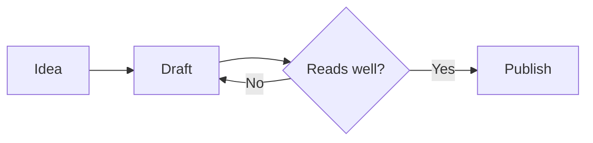
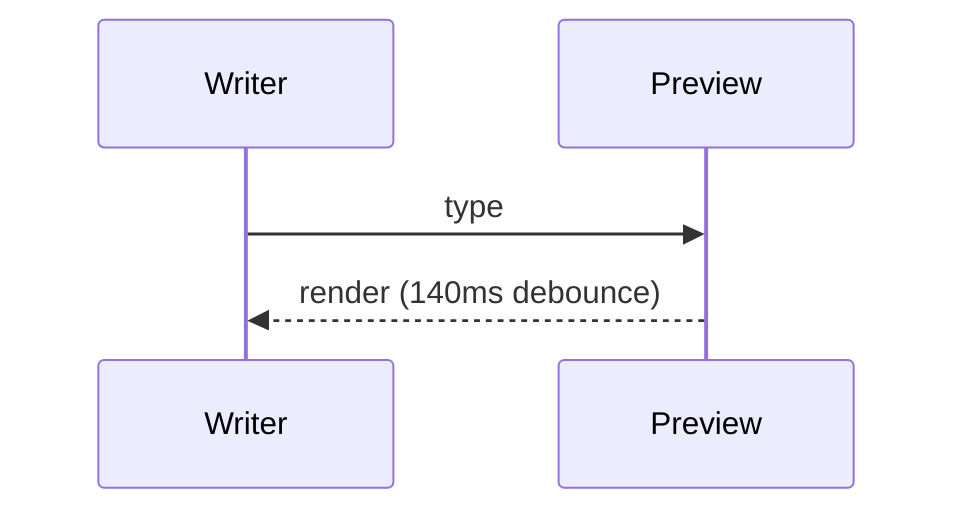

# Buity Markdown — showcase

Open this file and press `⌘K B` (macOS) or `Ctrl K B` to see the live preview.
This document exists to exercise every component the preview supports.

## Typography

Good writing deserves good typography. **Bold statements** carry weight, *quiet emphasis*
stays quiet, ~~old ideas get struck~~ and ==important phrases are highlighted==. You can
quote `inline code`, reference a footnote,[^1] and link to [the documentation](https://code.visualstudio.com/docs).

Paragraphs are set with a comfortable measure, generous leading and a warm ink tone, so long
documents stay readable for hours rather than minutes. Headings use a tighter optical scale,
which keeps a deep outline scannable.

### A third-level heading

#### A fourth-level heading

##### A fifth-level heading

## Callouts

::: tip Write first, format later
Markdown should never get in the way of thinking. Start with plain prose and add structure
once the idea is on the page.
:::

::: note Everything is local
No network requests, no accounts. Fonts, the diagram engine and the highlighter ship with
the extension.
:::

::: important Preview and source stay in sync
Scroll either side. Click a heading in the outline. Tick a task. The editor follows.
:::

::: warning Watch the nesting
Callouts can contain **lists**, `code` and even other callouts:

- A first point
- A second point

> A nested quote inside a callout.
:::

::: caution Irreversible actions
The `caution` variant uses the ember red used for destructive hints.
:::

::: example A worked example
1. Select the text you want to wrap
2. Run **Buity Markdown: Insert Callout** from the palette
3. Pick a type
:::

GitHub alerts work too:

> [!NOTE]
> This is a plain `> [!NOTE]` alert, converted into the same component.

## Lists and tasks

- A bullet with enough words to wrap onto a second line, which demonstrates the hanging indent
- Another bullet
  - A nested detail
  - One more nested detail
- [x] Ship a first version
- [ ] Write the remaining chapters
- [ ] Record a short demo

1. Ordered lists keep tabular numbers
2. So the digits line up
3. Even at two digits, and beyond

## Code

```typescript
interface Chapter {
  title: string;
  words?: number;
}

export function readingTime(chapters: Chapter[]): string {
  const words = chapters.reduce((total, chapter) => total + (chapter.words ?? 0), 0);
  // ~220 words per minute, rounded up
  return `${Math.max(1, Math.ceil(words / 220))} min`;
}
```

```bash
npm run build
npx vsce package
```

```json
{ "buityMarkdown.theme": "paper", "buityMarkdown.fontSize": 17 }
```

## Math

Inline math sits inside a sentence: $e^{i\pi} + 1 = 0$, and the Gaussian integral

$$
\int_{-\infty}^{\infty} e^{-x^{2}} \, dx = \sqrt{\pi}
$$

reads cleanly when displayed on its own line.

## Tables

| Component | Built-in preview | Buity |
| --- | :---: | ---: |
| Editorial typography | — | ✓ |
| Callouts | — | ✓ |
| KaTeX math | plugin | bundled |
| Mermaid diagrams | plugin | bundled |
| Outline + scroll sync | — | ✓ |
| HTML export | — | ✓ |

## Diagrams





## Details, keys and rules

<details>
<summary>Click to reveal a longer thought</summary>

Collapsible sections are useful for appendices, changelogs and answers that would otherwise
interrupt the flow. Press <kbd>⌘</kbd> + <kbd>K</kbd> then <kbd>B</kbd> to reopen the preview.

</details>

---

## 中文段落

Buity Markdown 同样照顾中文排版：正文 1.75 倍行距、段落间距克制，标题层级清晰，
行内代码与链接在中英文混排下也不会跳动。

> 好的排版不打扰阅读，只是让阅读发生。

[^1]: Footnotes are rendered at the bottom with a back-reference.
